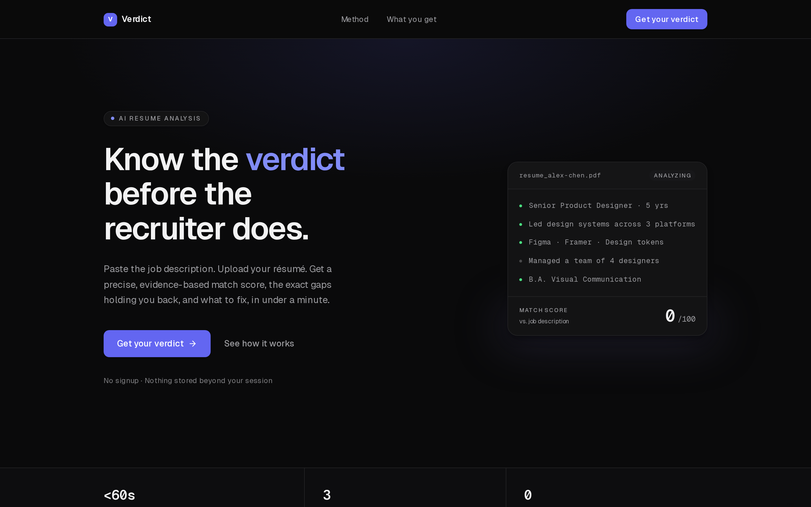
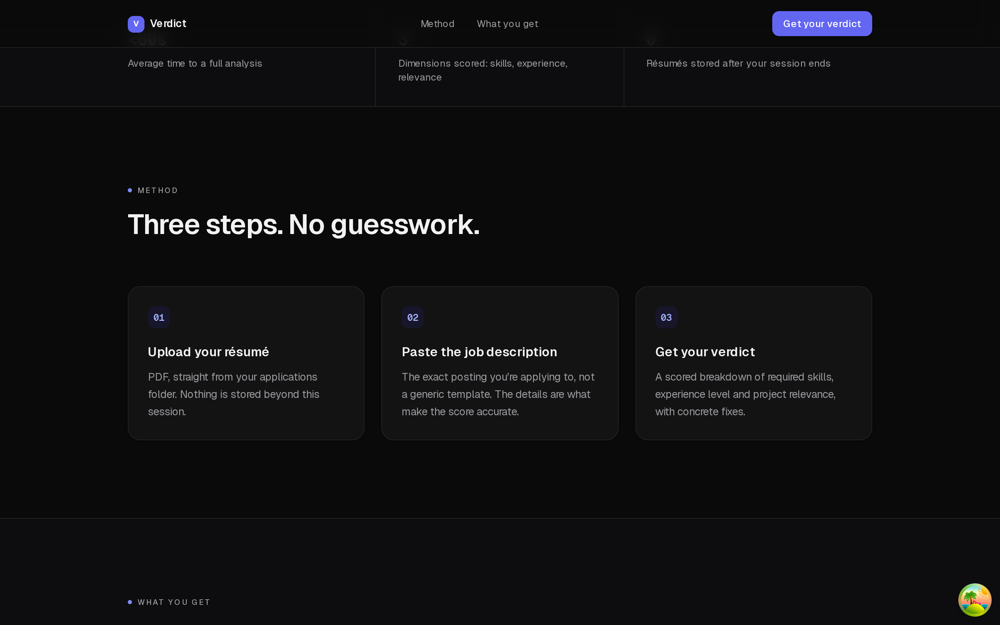
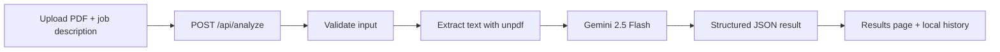
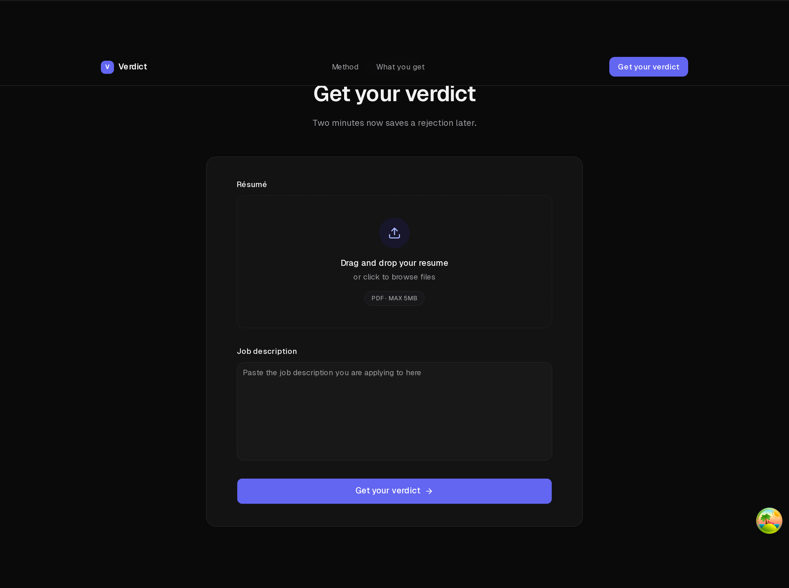
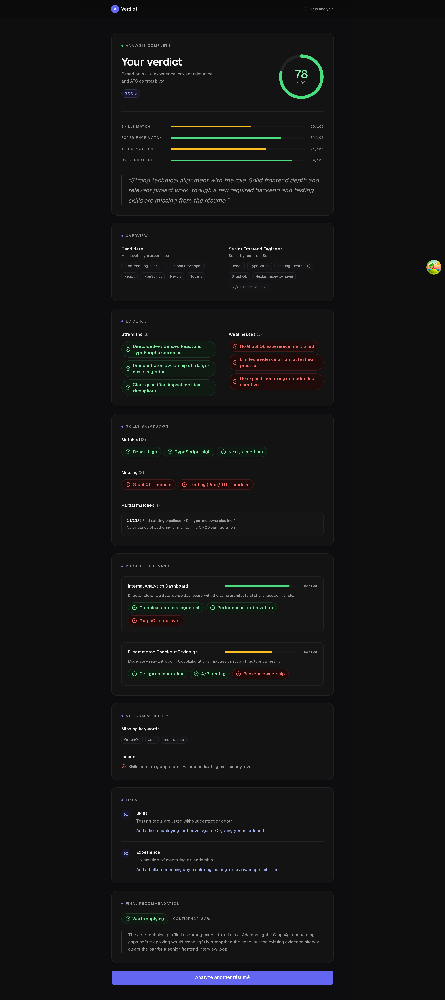

<div align="center">

# Verdict — AI Résumé Analyzer

**Know the verdict before the recruiter does.**<br />
Upload a résumé, paste a job description, and get an evidence-based match score instead of vague advice.




</div>

## Overview

Verdict compares a résumé (PDF) against a specific job posting and returns a structured, explainable analysis. It runs as a single full-stack Next.js application: the UI and the analysis API live in the same codebase, with no separate backend service and no database.

### Features

- **Match score (0–100)** with a rating (`Poor` / `Average` / `Good` / `Excellent`) and a short summary.
- **Score breakdown** across skills match, experience match, ATS keywords and CV structure.
- **Skills analysis** — matched skills with evidence from the CV, missing skills with recommendations, and partial matches with the level gap.
- **Project relevance** — each project in the résumé scored against the role's requirements.
- **ATS compatibility** — missing keywords and structural issues that automated screening may penalize.
- **Strengths & weaknesses** drawn directly from the résumé and the posting.
- **Actionable CV fixes** — concrete, section-by-section suggestions.
- **Final recommendation** — whether to apply, with a confidence level and reasoning.
- **Analysis history** — the last 20 analyses are kept locally in the browser and can be reopened or deleted.
- **Privacy-friendly** — no accounts, no database; résumés are processed in memory and never persisted on the server.



## How it works



1. The user uploads a PDF résumé and pastes the job description.
2. The route handler validates the request and extracts the text from the PDF.
3. The text is truncated to safe limits and sent to Gemini with a strict scoring prompt (`temperature: 0`) to keep results as deterministic as possible.
4. The JSON response is validated against a Zod schema and rendered on the results page.



## Results

The results page presents the full analysis — overall score ring, per-dimension bars, skills and project breakdowns, ATS findings, prioritized fixes and a final recommendation.



## Tech stack

| Area | Technology |
| --- | --- |
| Framework | [Next.js 16](https://nextjs.org) (App Router, Route Handlers, Turbopack), [React 19](https://react.dev) with React Compiler |
| Language | [TypeScript](https://www.typescriptlang.org/) |
| Styling & UI | [Tailwind CSS v4](https://tailwindcss.com/), [shadcn/ui](https://ui.shadcn.com/), [Radix UI](https://www.radix-ui.com/), [Lucide](https://lucide.dev/) |
| Data fetching | [TanStack Query](https://tanstack.com/query) |
| Forms | [React Hook Form](https://react-hook-form.com/) |
| State | [Zustand](https://zustand.docs.pmnd.rs/) with `persist` (localStorage) |
| Validation | [Zod](https://zod.dev/) |
| AI | [Google Gemini](https://ai.google.dev/) (`gemini-2.5-flash`) via [`@google/genai`](https://www.npmjs.com/package/@google/genai) |
| PDF parsing | [unpdf](https://github.com/unjs/unpdf) |
| Fonts | [Geist](https://vercel.com/font) Sans & Mono |
| Tooling | ESLint, Bun |

## Getting started

### Prerequisites

- [Bun](https://bun.sh/) (a `bun.lock` is committed; npm, yarn and pnpm work too)
- A [Google Gemini API key](https://aistudio.google.com/apikey)

### Installation

```bash
git clone https://github.com/iamdrzazgowski/resume-analyzer.git
cd resume-analyzer
bun install
```

### Environment variables

Copy the example file and add your key:

```bash
cp .env.example .env
```

| Variable | Required | Description |
| --- | --- | --- |
| `GEMINI_API_KEY` | Yes | API key used by the server to call Gemini. Never exposed to the client. |

### Run locally

```bash
bun dev
```

Open [http://localhost:3000](http://localhost:3000).

### Scripts

| Command | Description |
| --- | --- |
| `bun dev` | Start the development server |
| `bun run build` | Create a production build |
| `bun start` | Serve the production build |
| `bun run lint` | Run ESLint |

## API

### `POST /api/analyze`

Accepts `multipart/form-data`:

| Field | Type | Constraints |
| --- | --- | --- |
| `resume_file` | `File` | PDF only, max 5 MB |
| `job_description` | `string` | Min. 50 characters |

**Response `200`** — an `AnalysisResult` JSON object (see [`src/lib/schemas.ts`](src/lib/schemas.ts)):

```jsonc
{
  "id": "uuid",
  "overall_score": { "percentage": 78, "rating": "Good", "summary": "..." },
  "candidate_profile": { "seniority_level": "...", "years_of_experience": 4, "...": "..." },
  "job_analysis": { "job_title": "...", "required_skills": [], "preferred_skills": [], "...": "..." },
  "skills_analysis": { "matched_skills": [], "missing_skills": [], "partial_matches": [] },
  "experience_analysis": { "match_percentage": 82, "...": "..." },
  "project_analysis": [],
  "ats_analysis": { "keyword_match_score": 71, "cv_structure_score": 90, "...": "..." },
  "strengths": [],
  "weaknesses": [],
  "cv_improvement_suggestions": [],
  "final_recommendation": { "should_apply": true, "confidence": 82, "reasoning": "..." }
}
```

**Errors** — `400` for invalid input (missing file or description, non-PDF, file too large, description too short, unreadable PDF) and `500` if the analysis fails. Error responses have the shape `{ "detail": "..." }`.

> [!NOTE]
> The route sets `maxDuration = 60` to accommodate the Gemini call. When deploying to Vercel, make sure your plan allows function durations of that length.

## Project structure

```
.
├─ screenshots/                  # README images
├─ public/                       # Static assets
└─ src/
   ├─ app/
   │  ├─ api/analyze/route.ts    # POST /api/analyze
   │  ├─ history/page.tsx        # Saved analyses
   │  ├─ results/[id]/page.tsx   # Analysis results
   │  ├─ page.tsx                # Landing page
   │  ├─ layout.tsx
   │  ├─ providers.tsx           # TanStack Query provider
   │  └─ globals.css             # Design tokens and theme
   ├─ components/
   │  ├─ ui/                     # shadcn/Radix-based primitives
   │  ├─ hero-section.tsx, method-section.tsx, features-section.tsx, ...
   │  ├─ file-upload-form.tsx    # Upload + job description form
   │  ├─ score-ring.tsx, score-bar.tsx
   │  └─ scan-visual.tsx         # Animated hero visual
   ├─ hooks/
   │  ├─ useAnalyzeMutation.ts   # TanStack Query mutation
   │  └─ useFileDropzone.ts      # Drag-and-drop handling
   ├─ lib/
   │  ├─ gemini-service.ts       # Prompt, Gemini call, response parsing
   │  ├─ pdf-parser.ts           # PDF → text (unpdf)
   │  ├─ schemas.ts              # Zod schemas and inferred types
   │  ├─ validators/             # Client-side file validation
   │  └─ queryClient.ts
   └─ store/
      └─ analysisStore.ts        # Persisted result + history (Zustand)
```

## Design

Verdict ships a single, dark theme: a near-black background, Geist Sans for UI and Geist Mono for data and labels, hairline borders, and a restrained indigo accent used for interactive elements and highlights. Score colors (green / amber / red) are reserved for results.

## Privacy

- Résumés are parsed in memory on the server and are **not** stored.
- Analysis results and history are kept only in your browser's `localStorage` (up to 20 entries) and can be removed from the history page at any time.
- The extracted résumé text and the job description are sent to the Google Gemini API for analysis — review Google's terms before using real personal data.

## Deployment

The easiest way to deploy is [Vercel](https://vercel.com/new): import the repository, set `GEMINI_API_KEY` in the project's environment variables, and deploy.
